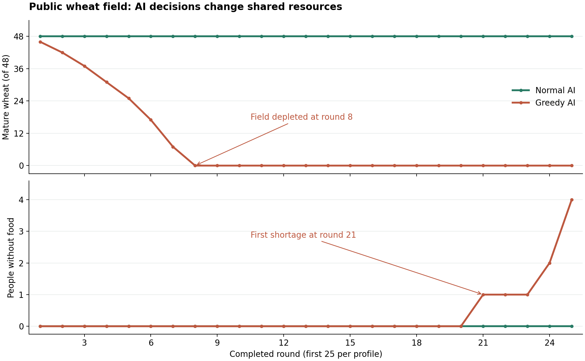

# VillageCommons · AI NPC 公共麦田演化原型

基于 Minecraft Paper 的可运行原型：四名村民由大模型模拟决策，共同收割一片公共麦田。不同的角色动机会影响个人储粮和公共资源，让“适度收割维持供给”与“过度收割导致枯竭”在游戏世界中直接可见。

项目关注 **AI决策如何转化为持续的世界状态变化**。当前玩家可以切换实验、推进回合、观察麦田并查看村民理由与记忆。

版本 **0.3.1** · Minecraft Java **1.21.11** · Paper **build 132** · Java **21+** · Windows启动脚本

## 实际运行结果

2026年10月5日，普通组记录了50个已完成回合，激进组记录了25个已完成回合。全部回合日志均标记为 `source=AI`，以下主对照取两组的前25回合。

| 指标 | 普通AI | 激进AI |
| --- | --- | --- |
| 初始资源 | 48株成熟小麦，四人各1份库存 | 相同 |
| 第25回合成熟小麦 | 48/48 | 0/48 |
| 公共麦田首次耗尽 | 25回合内未出现 | 第8回合 |
| 首次有人缺粮 | 25回合内未出现 | 第21回合 |
| 第25回合缺粮人数 | 0人 | 4人 |
| 额外观察 | 继续到第50回合，仍满田且无人缺粮 | 本次记录截至第25回合 |



普通组前25回合每轮收割6株、恢复6株。激进组前7回合每轮收割11～12株，恢复逐渐减弱，第8回合收割剩余7株后麦田耗尽。此前积累的私人库存继续提供口粮，因此公共资源枯竭后经过多轮才出现缺粮。

- [普通组原始日志：50回合](experiments/2026-10-05/normal.log)
- [激进组原始日志：25回合](experiments/2026-10-05/greedy.log)
- [逐回合CSV：75个已完成回合](experiments/2026-10-05/rounds.csv)
- [统计摘要](experiments/2026-10-05/summary.json) · [实验说明](experiments/README.md)

两组各记录一次，起点与资源规则相同，角色性格和模式提示不同。结果展示本次运行中动机差异对应的资源轨迹，不代表模型在重复运行中一定得到相同结果。日志未包含具体模型ID、采样参数及四人各自的详细意图，分析以记录可支持的内容为限。

## 资源规则

麦田为7×7区域，中央一格水源，其余48格为小麦。四名村民每回合分别申请收割0～3株，收获归个人库存。资源不足时逐人逐株分配，并按回合轮换优先顺序。

每回合按 **收割 → 麦田恢复 → 消耗口粮** 的顺序结算：

```text
R = 收割后剩余成熟株数
恢复量 = min(48 - R, floor(R / 4))
每人从自己的库存消耗1份口粮，口粮不足才计为缺粮
```

满田时总收割量不超过9株，可以恢复至48株；超过这一范围会开始出现空缺。剩余0～3株时恢复量为0。世界关闭原版随机生长，实际麦株由插件与资源账本同步更新。

这是教学用资源模型；没有投票、收割限额或额外补种干预。插件不固定普通组的收割量，也不强制激进组收割3株或耗竭。

## AI如何参与

| 环节 | 实现 |
| --- | --- |
| 输入 | 麦田状态、上一回合收割与恢复、四人的库存、性格、最近五回合记忆 |
| 模型输出 | 四名村民各自的收割意图、个人理由和本回合观察，使用JSON协议 |
| 插件执行 | 验证四人决策，执行分配、收割动画、恢复、口粮消耗与状态保存 |
| 异常处理 | API错误、无效决策或请求额度用尽时自动暂停，保留原状态 |

普通模式强调当前口粮与长期粮源；激进模式强调个人储粮、眼前收益与抢先收割。两组使用同一套结算公式。

**四个角色由一次模型请求共同模拟**，共享状态上下文，没有独立请求或信息隔离。AI知道恢复公式和全局麦田情况，只能返回规定范围的决策，不能执行任意代码或凭空增加资源。

## 快速启动

1. 下载并解压项目，进入包含 `start.bat` 的文件夹，双击运行。
2. 按提示填写完整的 Chat Completions Endpoint、API Key 和准确的 Model ID。首次运行需阅读并同意 Minecraft EULA。
3. 等待服务器窗口出现 `Done`，用 Minecraft Java **1.21.11** 连接 **127.0.0.1:25565**，无需客户端Mod。
4. 游戏内输入 `/village` 打开面板；右键村民查看库存、决策理由与记忆。

项目已附编译插件 `dist/VillageCommons.jar`。脚本优先使用本机Java，缺少时下载便携JDK，并下载匹配的Paper。使用云端模型需自行提供兼容API配置。退出时在服务器窗口输入 `stop`。

运行普通组：

```text
/village scenario ai
/village speed 5
/village auto on
```

切换激进组：

```text
/village scenario ai-greedy
/village auto on
```

两条 `scenario` 命令均重置为相同初始资源并暂停自动运行。到目标回合后输入 `/village auto off`。自动间隔从上一回合完成后计算，模型请求和动画另外占用时间；村内无人时不推进自动回合。

默认每次启动最多30次API请求。运行两组各25回合时，可将本地 `server/plugins/VillageCommons/api.local.json` 中的 `maxRequests` 提高至 `100`，保存后输入 `/village reload`。失败请求和兼容重试也计入请求数，切换或重置实验不会清零。

暂停后修复配置或提高上限，执行 `/village reload`，再执行 `/village auto on`，即可继续尚未结算的回合。请求上限属于插件本地设置，与API账户余额无关。

完整命令表、存档与更新方法见 [使用说明](docs/USAGE.md)。API配置、服务器地图和下载环境生成于本地，`.gitignore` 已排除这些目录；仓库中的 `api.example.json` 仅含占位符。

## 源码与验证

主要实现位于 `src/main/java/io/github/xhy214/village/`：

| 目录 | 职责 |
| --- | --- |
| `ai/` | 提示词、状态输入、HTTP调用和请求预算 |
| `core/` | 世界状态、四人决策验证和资源结算 |
| `ui/` | 麦田、村民、动画与实验面板 |
| `data/` | 存档、回合日志和CSV记录 |

Windows双击 `build.bat` 可重建插件；已配置Java21和Maven的环境可运行 `mvn verify`。

版本0.3.1已通过 **33项单元测试、17项真实Paper服务器集成检查**。自动集成检查使用本地模拟API；上方实验结果来自用户实际运行日志，两者分别记录。详情见 [验证记录](docs/VALIDATION.md)、[设计说明](docs/DESIGN.md)。

可从公开日志重新生成统计与CSV：

```text
python tools/analyze_experiment.py
```

生成趋势图需先安装 `tools/requirements-report.txt` 中的依赖，再运行 `python tools/analyze_experiment.py --chart`。这些分析工具不访问API。

## License

项目源码采用 [MIT License](LICENSE)。
